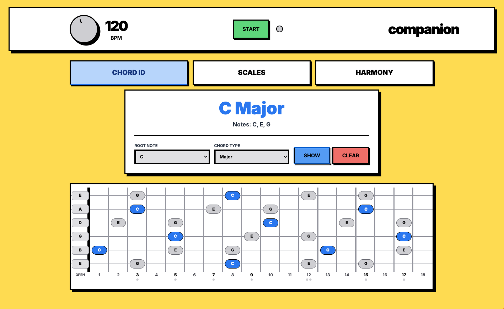

# Guitar Chord Companion (Chord Finder)

<p align="center">
  
</p>

**Guitar Chord Companion** é uma ferramenta "tudo-em-um" de teoria musical e exploração de braço para guitarristas, construída com um visual **Neo-Brutalista** responsivo (desktop e mobile).

O projeto pode ser executado tanto como um **aplicativo desktop nativo** (via **Tauri v2 / Rust**) quanto diretamente no navegador através do arquivo único autossuficiente (`chord_identifier.html`).



---

## Funcionalidades

O aplicativo conta com um cabeçalho global com **Metrônomo** e **quatro abas principais** (`CHORD ID`, `SCALES`, `HARMONY` e `INVERSIONS`):

### 1. Metrônomo Global (Header)
- **Controle de BPM Interativo:** Ajuste de `30` a `240 BPM` arrastando o *knob* circular (suporte a mouse e toque).
- **Alta Precisão Rítmica:** Agendamento de *ticks* via **Web Audio API**, com acentuação sonora e visual no tempo `1` do compasso `4/4`.
- **Layout Responsivo:** Adaptado tanto para telas desktop quanto para dispositivos móveis.

### 2. Aba `CHORD ID` (Identificador, Construtor e Transpositor de Acordes)
- **Braço Interativo com Toggle:** Clique em qualquer casa ou corda solta para adicionar uma nota; clique novamente na mesma nota para removê-la individualmente (sem precisar limpar o braço inteiro).
- **Transposição no Braço (`◀ -1 FRET` / `+1 FRET ▶`):** Desloque todo o formato/acorde atual para trás ou para frente no braço da guitarra em 1 semitom e veja instantaneamente qual novo acorde (ou inversão) as notas formam.
- **Identificação Inteligente de Acordes:**
  - Reconhece **díades** (Power Chords), **tríades**, **tétrades**, **acordes estendidos** (`9`, `11`, `13`, alterados) e **shell voicings**.
  - **Detecção de Baixo e Inversões (*Slash Chords*):** Identifica automaticamente a nota mais grave considerando a altura real (*pitch*) das 6 cordas (ex.: `Cmaj7 / E`, `G Major / B`).
- **Chord Builder (Construtor Reverso):** Escolha uma tônica e qualidade de acorde (ou clique em uma das interpretações detectadas) para visualizar todas as notas e intervalos daquele acorde mapeados pelo braço.

### 3. Aba `SCALES` (Visualizador de Escalas)
- **Mapeamento Completo:** Selecione a nota fundamental (*Root Note*) e o tipo de escala (*Major*, *Minor Natural/Harmonic/Melodic*, *Pentatonics*, *Blues*, *Modes*).
- **Destaque de Tônica:** Todas as tônicas da escala recebem destaque em azul (`scale-root`), facilitando a visualização de *shapes* e pontos de ancoragem em todas as regiões do braço.

### 4. Aba `HARMONY` (Campo Harmônico & Mapa Customizável de Inversões)
Possui dois modos de visualização intercambiáveis:
- **`CUSTOM HARMONY MAP (ALL CHORDS)`:**
  - Visualize **todos os acordes de um campo harmônico (`I` a `vii`) simultaneamente no braço da guitarra**, cada grau com sua própria cor e etiqueta (`I:R`, `IV:3`, `V:5`, etc.).
  - **Inversões Dinâmicas por Acorde:** Escolha individualmente qual inversão usar para cada grau da harmonia (`Root (/C)`, `1st Inv (/E)`, `2nd Inv (/G)`, `3rd Inv (/B)`) e em qual grupo de cordas/posição tocar.
  - **Destaque de Notas em Comum (*Common Tones*):** Casas compartilhadas por mais de um acorde ativo são destacadas em dourado (ex.: `I+vi`, `ii+V`), revelando conexões harmônicas no braço.
  - **Presets de Progressão & `AUTO VOICE-LEAD`:** Filtre rapidamente progressões clássicas (`ALL (I–vii)`, `I – IV – V`, `ii – V – I`, `I – vi – ii – V`) e use o botão **`AUTO VOICE-LEAD`** para que o app selecione automaticamente a inversão de cada acorde que permanece na mesma região do braço do grau `I`.
- **`SINGLE CHORD FULL NECK`:**
  - Mapa clássico em todo o braço para um único grau selecionado do campo harmônico, alternando entre visualização de **Intervalos (`R, 3, 5, 7`)** e **Notas (`C, E, G, B`)**.

### 5. Aba `INVERSIONS` (Explorador Passo a Passo de Inversões)
- **Fretboard no Topo:** O braço da guitarra fica posicionado logo abaixo da seleção de tom e qualidade do acorde (`ROOT NOTE` e `CHORD QUALITY`) para acompanhamento visual imediato a cada mudança de tonalidade ou inversão.
- **1. Navegação de Inversões (*Slash Chords*):** Avance ou retroceda pelas inversões uma de cada vez (`Cmaj7 / C` → `Cmaj7 / E` → `Cmaj7 / G` → `Cmaj7 / B`) com os botões `◀ PREV` / `NEXT ▶` ou pelos seletores rápidos.
- **2. Navegação por Conjunto de Cordas (*String Sets*):** Veja um *shape* tocável de cada vez percorrendo os diferentes grupos de cordas (`Strings 6-5-4-3`, `Strings 5-4-3-2`, `Strings 4-3-2-1`, `Drop 3` ou sets de tríades), com rolagem automática do braço para a região do acorde e destaque diferenciado para a **Nota do Baixo** (verde), **Tônica** (azul) e **Demais Vozes** (amarelo).

---

## Tecnologias Utilizadas

- **Frontend:** HTML5, Tailwind CSS, Vanilla JavaScript e Web Audio API
- **Desktop App:** [Tauri v2](https://v2.tauri.app/) (Rust + WebKitGTK)

---

## Como Executar e Compilar

### Opção 1: Aplicativo Desktop (Tauri)

Pré-requisitos: **Node.js**, **Rust / Cargo** e dependências do Tauri v2 para Linux (`webkit2gtk-4.1`, `librsvg`, etc.).

```bash
# Instalar dependências JS
npm install

# Rodar em modo de desenvolvimento
npm run dev

# Gerar build otimizada de produção (binário + pacotes .deb e .rpm)
npm run build
```

O binário compilado ficará disponível em:
```bash
./src-tauri/target/release/guitar-chord-companion
```

> **Nota para Linux / Wayland (Hyprland / Omarchy):** O binário já configura automaticamente `WEBKIT_DISABLE_DMABUF_RENDERER=1` na inicialização para evitar erros de protocolo Wayland com o WebKitGTK.

### Opção 2: Versão Web Autossuficiente (Arquivo Único)

Basta abrir o arquivo `chord_identifier.html` (ou `src/index.html` após rodar `npm run build:css`) diretamente em qualquer navegador moderno.
