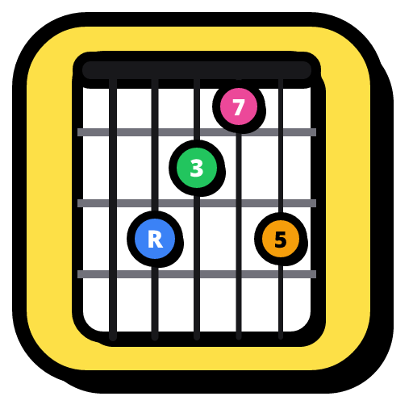

# Guitar Chord Companion (Chord Finder)

<p align="center">
  
</p>

**Guitar Chord Companion** is an all-in-one music theory and fretboard exploration tool for guitarists.

The project can run either as a **native desktop application** (powered by **Tauri v2 / Rust**) or directly in any modern browser using the standalone single-file version (`chord_identifier.html`).

## Features

The application features a persistent global header with a **Metronome** and **four main tabs** (`CHORD ID`, `SCALES`, `HARMONY`, and `INVERSIONS`):

### 1. Global Metronome (Header)
- **Interactive BPM Knob:** Adjust tempo from `30` to `240 BPM` by dragging the circular knob (supports both mouse and touch input).
- **High-Precision Audio Scheduling:** Uses the **Web Audio API** lookahead scheduler for rock-solid timing, featuring an accented audio click and visual blue pulse on beat `1` of a `4/4` bar.
- **Responsive Header Layout:** Cleanly adapts to both desktop and mobile viewports.

### 2. `CHORD ID` Tab (Chord Identifier, Reverse Builder & Fretboard Transposer)
- **Interactive Toggle Fretboard:** Click any fret or open string to place a note; click an active note again to remove it individually without clearing the entire fretboard.
- **Fretboard Transposition (`◀ -1 FRET` / `+1 FRET ▶`):** Shift the entire chord shape up or down the neck by 1 semitone at a time and immediately see the newly generated chord name and notes.
- **Smart Chord Detection:**
  - Recognizes **dyads** (Power Chords), **triads**, **seventh chords**, **extended/altered chords** (`9`, `11`, `13`), and **shell voicings**.
  - **Slash Chord & Inversion Detection:** Accurately determines the lowest-pitched note across all 6 strings to identify inversions (e.g., `Cmaj7 / E`, `G Major / B`).
- **Reverse Chord Builder:** Pick any Root Note and Chord Quality (or click any detected chord interpretation) to map all of its notes and intervals across the fretboard.

### 3. `SCALES` Tab (Scale Visualizer)
- **Full-Neck Mapping:** Choose a **Root Note** and **Scale Type** (*Major*, *Natural/Harmonic/Melodic Minor*, *Pentatonics*, *Blues*, *Modes*).
- **Root Highlighting:** Every root note is highlighted in blue (`scale-root`), making it easy to spot anchor points and scale patterns across all fretboard positions.

### 4. `HARMONY` Tab (Harmonic Fields & Custom Multi-Chord Inversion Map)
Includes two switchable visualization modes:
- **`CUSTOM HARMONY MAP (ALL CHORDS)`:**
  - View **all chords of a harmonic field (`I` through `vii`) simultaneously on the guitar fretboard**, each with its own color-coded degree badge (`I:R`, `IV:3`, `V:5`, etc.).
  - **Per-Chord Dynamic Inversions:** Independently choose which inversion to use for each degree in the harmony list (`Root (/C)`, `1st Inv (/E)`, `2nd Inv (/G)`, `3rd Inv (/B)`) as well as its fretboard position/string group.
  - **Common Tone Highlighting:** Fretboard positions shared by multiple active chords are highlighted in gold (e.g., `I+vi`, `ii+V`), making harmonic connections and shared notes immediately visible.
  - **Progression Presets & `AUTO VOICE-LEAD`:** Quickly filter classic progressions (`ALL (I–vii)`, `I – IV – V`, `ii – V – I`, `I – vi – ii – V`) and click **`AUTO VOICE-LEAD`** to automatically select the inversion of each chord that stays closest to Degree `I`'s fret region.
- **`SINGLE CHORD FULL NECK`:**
  - Classic full-fretboard map for a single selected chord from the harmonic field, with a toggle between **Intervals (`R, 3, 5, 7`)** and **Note Names (`C, E, G, B`)**.

### 5. `INVERSIONS` Tab (Step-by-Step Inversion Explorer)
- **Top-Anchored Fretboard:** Positioned right below the **ROOT NOTE** and **CHORD QUALITY** selectors so you can immediately see changes on the neck as you switch keys, qualities, or inversions.
- **Pinned String Group (`📌 PINNED`):** Lock a specific string set once (e.g., `Strings 4-3-2-1`, `Strings 5-4-3-2`, `Strings 6-5-4-3`, or `Drop 3 (6-4-3-2)`) and step through all inversions (`Cmaj7 / C` → `Cmaj7 / E` → `Cmaj7 / G` → `Cmaj7 / B`) on that exact string group with a single click on **`NEXT INV ▶`** or **`◀ PREV INV`**.
- **Color-Coded Voice Roles:** Clearly distinguishes the **Inversion Bass Note** (green), **Chord Root** (blue), and **Other Chord Tones** (yellow), while automatically scrolling the fretboard to center the active voicing.

---

## Tech Stack

- **Frontend:** HTML5, Tailwind CSS, Vanilla JavaScript, and Web Audio API
- **Desktop Application:** [Tauri v2](https://v2.tauri.app/) (Rust + WebKitGTK)
- **CI / CD:** GitHub Actions (`.github/workflows/release.yml`) for automated Linux, Windows, and macOS release builds

---

## Getting Started & Building

### Option 1: Native Desktop App (Tauri)

Prerequisites: **Node.js**, **Rust / Cargo**, and Tauri v2 system dependencies (such as `webkit2gtk-4.1` and `librsvg` on Linux).

```bash
# Install JS dependencies
npm install

# Run in development mode
npm run dev

# Build optimized production binary and Linux packages (.deb & .rpm)
npm run build
```

The compiled release binary will be located at:
```bash
./src-tauri/target/release/guitar-chord-companion
```

> **Linux / Wayland Note (Hyprland / Omarchy):** The Rust binary automatically sets `WEBKIT_DISABLE_DMABUF_RENDERER=1` at startup on Linux to prevent Wayland protocol error 71 with WebKitGTK.

### Option 2: Standalone Single-File Web Version

Simply open `chord_identifier.html` (or `src/index.html` after running `npm run build:css`) directly in any modern web browser—no server required.
